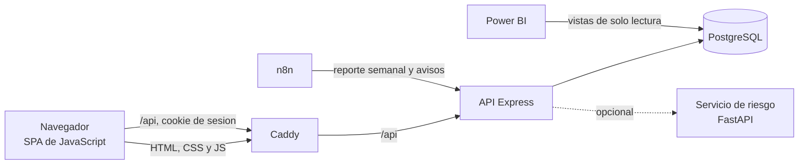

# StudentScope MJ - Panel de Gestión Educativa

StudentScope MJ es una aplicación web para gestionar y monitorear estudiantes. El frontend es una Single Page Application sin frameworks (JavaScript y CSS puros) que habla con una API propia y una base de datos PostgreSQL.

Repositorios del proyecto:

* Frontend: `studentscope-mj-frontend` (este repositorio).
* Backend: `studentscope-mj-backend`: API, base de datos, servicio de riesgo de abandono, plantillas de n8n y vistas para Power BI.

Demo en vivo: <https://studentscopemj.pamcing.me> (entra con "Probar la demo").

Hecho por María José Montepeque Zet.

---

## Características principales

* **SPA con enrutador ligero:** navegación entre Landing, Login, Registro y Dashboard sin recargar la página.
* **Cuentas y roles:** registro de usuarios, inicio de sesión real contra la API y panel de administración de cuentas (editar, eliminar, hacer o quitar administrador).
* **Dashboard analítico:** indicadores clave y gráficas con Chart.js.
* **Gestión de estudiantes (CRUD):**
  * Vista en tarjetas.
  * Búsqueda y filtros por nombre, ciudad, plan y estado, resueltos en el servidor.
  * Paginación del servidor.
  * Formularios modales para agregar, editar y eliminar, guardados en la base de datos a través de la API. Los errores del servidor se muestran junto al campo correspondiente.
* **Catálogo de cursos:** 30 cursos filtrables por categoría, con el número real de inscritos.
* **Reportes (solo administrador):** ingresos, retención, progreso promedio, gráficas por plan y por rango de progreso, y Top 10 de estudiantes.
* **Configuración:** exportación a JSON y CSV de todos los estudiantes, descargados desde la API.
* **Notificaciones:** panel del administrador con alertas calculadas a partir de los reportes (inactivos, cursos completados, progreso bajo).
* **Sidebar accesible:** menú colapsable con control de foco, cierre con Escape y adaptación a móvil.
* **Motor de validación:** módulo independiente con 20 reglas de negocio sobre el dataset.

---

## Arquitectura



* **Caddy** sirve los archivos estáticos y reenvía `/api` a la API. Es también quien pone las cabeceras de seguridad (política de contenido, HSTS).
* **La API** guarda la sesión en una cookie `HttpOnly` y valida todo en el servidor, además de en el navegador. Tiene roles: administrador, usuario normal y una cuenta de demostración.
* **PostgreSQL** impone las reglas de los datos (rangos, claves foráneas, correos únicos), no solo la API.
* **El servicio de riesgo, n8n y Power BI son opcionales.** La aplicación funciona sin ellos.

---

## Tecnologías utilizadas

* **Estructura y estilos:** HTML5 semántico y CSS puro (variables, Flexbox, Grid).
* **Lógica:** JavaScript vanilla con módulos ES (`type="module"`) para la aplicación y scripts clásicos para las utilidades.
* **Servidor:** API en Node.js con Express y PostgreSQL (repositorio del backend), servida detrás de Caddy.
* **Gráficas:** Chart.js 4.4.0, cargado desde CDN.
* **Fuentes:** Google Fonts (Syne, DM Sans).

---

## Estructura del proyecto

| Archivo | Descripción |
| :--- | :--- |
| `index.html` | Estructura de todas las vistas (Landing, Login, Dashboard y modales). |
| `css/Style.css` | Estilos globales: variables, tipografía, botones, insignias, toasts y Landing. |
| `css/Dashboard.css` | Estilos del panel: Sidebar, Topbar, indicadores y tablas. |
| `css/Estudiantes.css` | Estilos de la gestión de estudiantes: tarjetas, filtros, paginación y modales. |
| `js/App.js` | Punto de entrada (módulo ES): arranca la aplicación, reparte los clics por `data-action` y publica la API de `window.StudentScope`. |
| `js/app/Estado.js` | Objeto `state` y atajos a las utilidades compartidas. |
| `js/app/Router.js` | Cambio de vista y de sección del panel. |
| `js/app/Sesion.js` | Inicio de sesión, registro, demo, cierre y restauración de la sesión. |
| `js/app/Permisos.js` | Quién es administrador, demo o puede gestionar, y qué se muestra según el rol. |
| `js/app/Datos.js` | Peticiones a la API y tarjetas de indicadores. |
| `js/app/Estudiantes.js` | Lista, filtros, paginación, formulario, validación y baja de estudiantes, y la gráfica del dashboard. |
| `js/app/Cursos.js`, `Reportes.js`, `Configuracion.js`, `Notificaciones.js` | Una sección cada uno. |
| `js/app/Interfaz.js` | Avisos, errores de campo, confirmación y otras ayudas de pantalla. |
| `js/Sidebar.js` | Control del menú lateral: eventos, accesibilidad y cambio de tamaño. |
| `js/Catalogo.js` | Catálogo oficial de 30 cursos: única fuente para la interfaz y el validador. |
| `js/Validacion.js` | Motor de validación con 20 reglas de negocio, para un dataset completo o para un registro. |
| `js/Csv.js` | Generación del archivo CSV: comillas, saltos de línea y protección contra fórmulas de hoja de cálculo. |
| `js/vendor/avatares.js` | Generador de avatares (DiceBear, estilo voxel-art) empaquetado para el navegador. No se edita a mano: se genera con `npm run build:avatares`. |
| `css/Avatares.css` | Tamaños y recorte circular de los avatares. |
| `scripts/avatares-entrada.mjs` | Código fuente del generador de avatares; `avatares-opciones.mjs` guarda la configuración (colores y probabilidades) y `construir-avatares.mjs` lo empaqueta con esbuild. |
| `js/Escapar.js` | Utilidades de seguridad: escape de HTML y conversión segura a número. |
| `js/Iconos.js` | Iconos SVG propios y función que los inserta en los elementos con `data-icono`. |
| `js/Api.js` | Cliente de la API: envía las cookies de sesión, traduce errores y avisa cuando la sesión expira. |
| `js/Cuentas.js` | Sección Cuentas del administrador: lista, búsqueda, edición, cambio de rol y eliminación. |
| `css/Cuentas.css` | Estilos de la gestión de cuentas. |
| `scripts/servir.mjs` | Servidor local de desarrollo: sirve el frontend y reenvía `/api` al backend. |
| `json/Datos.json` | Dataset de ejemplo de 35 estudiantes, solo de referencia: la aplicación ya no lo usa. |
| `test/` | Pruebas automáticas con Vitest: las 20 reglas del validador y las utilidades de escape. |
| `package.json` | Scripts y herramientas de desarrollo (solo para pruebas y calidad de código; la aplicación no las usa). |
| `eslint.config.mjs` | Reglas de ESLint para el código del navegador, las pruebas y el validador. |
| `vitest.config.mjs` | Configuración de Vitest. |
| `.prettierrc.json` | Estilo de formato para pruebas y archivos de configuración. |

---

## Instalación y uso

El frontend necesita el backend (`studentscope-mj-backend`) para iniciar sesión, porque las cuentas viven en su base de datos.

1. Clona los dos repositorios y levanta el backend siguiendo su README (PostgreSQL, variables de entorno y `npm start`).
2. En este repositorio:

```bash
npm install
npm run dev
```

3. Abre `http://localhost:5173`.

`npm run dev` sirve los archivos del frontend y reenvía las peticiones `/api` al backend en `http://127.0.0.1:3100`. Se pueden cambiar con las variables `PORT` y `API_URL`.

Con la cookie de sesión no se puede abrir `index.html` directamente ni servirlo con una extensión que no reenvíe `/api`: el navegador no podría llegar a la API.

Los nombres de archivos y carpetas distinguen mayúsculas y minúsculas en servidores Linux (por ejemplo, `css/Style.css`).

Estudiantes, cursos, resumen y reportes vienen de la API (PostgreSQL), así que todos los usuarios ven los mismos datos. Un usuario normal solo recibe el catálogo de cursos y el resumen en números; el servidor le niega los datos de estudiantes. Para que haya datos de ejemplo en el backend local, usa `npm run db:sembrar` allí.

---

## Levantar todo con Docker

Sirve para ver la aplicación completa (base de datos, API y frontend) con un solo comando, sin instalar PostgreSQL ni Node. Necesitas Docker con Compose.

1. Clona los dos repositorios uno junto al otro:

```bash
git clone https://github.com/MariaJoseMontepequeZet/studentscope-mj-backend.git
git clone https://github.com/MariaJoseMontepequeZet/studentscope-mj-frontend.git
```

2. Copia el archivo de ejemplo de variables y complétalo (`DB_PASSWORD` y `JWT_SECRET` son obligatorias; el secreto debe tener al menos 32 caracteres):

```bash
cd studentscope-mj-frontend/despliegue
cp .env.example .env
```

3. Construye y levanta:

```bash
docker compose --env-file .env up -d --build
```

4. Abre `http://localhost:8080`. Con `ADMIN_EMAIL` y `ADMIN_PASSWORD` entras como administrador, y con `SEMBRAR_EJEMPLO=true` hay 35 estudiantes de ejemplo.

Para apagarlo: `docker compose --env-file .env down`. Agrega `-v` para borrar también la base de datos.

Esta configuración es para probar en tu equipo: sirve por HTTP en el puerto 8080 y no incluye HTTPS. El despliegue real usa su propia configuración, fuera del repositorio.

---

## Cuentas y roles

* **Registro:** cualquiera crea una cuenta desde la pantalla de registro. Las cuentas nuevas son siempre `usuario`.
* **Usuario:** ve el Dashboard, el catálogo de Cursos y su propio perfil (cambiar nombre y contraseña). No ve estudiantes, reportes, notificaciones ni cuentas.
* **Administrador:** además gestiona estudiantes, reportes y la sección **Cuentas**, donde puede editar nombre, correo y contraseña de cualquiera, hacer o quitar el rol de administrador y eliminar cuentas.
* Siempre queda al menos un administrador, y nadie puede eliminar su propia cuenta desde esa sección.
* El primer administrador lo crea el backend al iniciar, a partir de `ADMIN_EMAIL` y `ADMIN_PASSWORD`.
* La sesión vive en una cookie `HttpOnly` que el navegador no deja leer desde JavaScript. Si la cuenta se elimina o la sesión caduca, la aplicación vuelve al inicio de sesión.

Aviso: los datos de los estudiantes todavía están en el navegador, así que el control de acceso a esa parte es solo visual. Los permisos de las cuentas sí los aplica el servidor. Cuando los estudiantes pasen a la API, los permisos cubrirán también esos datos.

---

## Pruebas y calidad del código

Las herramientas de desarrollo necesitan Node.js 22 o superior. La aplicación en sí no las necesita.

```bash
npm install
npm test
npm run lint
npm run format:check
```

| Comando | Descripción |
| :--- | :--- |
| `npm test` | Ejecuta todas las pruebas con Vitest. |
| `npm run test:watch` | Ejecuta las pruebas y las repite al guardar cambios. |
| `npm run lint` | Revisa el código con ESLint. |
| `npm run format` | Da formato con Prettier a las pruebas y a los archivos de configuración. |

Las pruebas cargan `js/Validacion.js` y `js/Escapar.js` con `require`, porque esos archivos también funcionan en Node sin cambios. Cada regla V-01 a V-20 tiene al menos un caso que debe detectarse y otro que debe aceptarse.

---

## Arquitectura de JavaScript

La aplicación está dividida en módulos ES dentro de `js/app/` (uno por sección) y arranca desde `js/App.js`. Las utilidades (`Api.js`, `Escapar.js`, `Csv.js`, `Iconos.js`, `Validacion.js`, `Cuentas.js`, `Sidebar.js`) son scripts clásicos que cuelgan de `window.StudentScope`, el único objeto global.

* **Estado centralizado:** `js/app/Estado.js` mantiene un objeto `state` con la vista actual, los estudiantes, los filtros y las instancias de las gráficas.
* **Renderizado:** los componentes se vuelven a pintar con plantillas de texto cuando cambia el estado.
* **Seguridad:** todo dato de estudiante que se inserta en una plantilla pasa por `escaparHTML()` (o `aNumero()` si es numérico), y los mensajes emergentes se crean con nodos de texto. Así un nombre como `` se muestra como texto y no se ejecuta.
* **Sesión y roles:** `js/app/Sesion.js` guarda el usuario actual en `state.usuario`. Los elementos marcados con `data-solo-admin` se ocultan para quien no es administrador y las secciones de administración vuelven al Dashboard si se intentan abrir sin permiso.
* **Iconos:** la interfaz no usa emojis. Los iconos son SVG definidos en `Iconos.js`; el HTML los pide con `data-icono="nombre"` y las plantillas de JavaScript con `StudentScope.icono('nombre')`.
* **Eventos:** no hay manejadores en línea (`onclick`). Los botones declaran `data-action` (y `data-id` o `data-page` cuando hace falta) y un único oyente de clic en `js/App.js` ejecuta la acción correspondiente. Esto permite una política de seguridad de contenido sin `unsafe-inline` en los scripts.

---

## Motor de validación (`js/Validacion.js`)

Clasifica los problemas en tres niveles:

1. **ERROR:** el registro no es utilizable (por ejemplo, ID duplicado, fecha inválida o monto que no coincide con el plan).
2. **WARNING:** incoherencia de negocio que requiere revisión (por ejemplo, inactivo con bajo progreso).
3. **INFO:** observación general (por ejemplo, saltos en la secuencia de IDs).

Uso en el navegador:

```javascript
const resultado = StudentScope.validar.dataset(estudiantes);
console.log(resultado.reporte);
const registrosSeguros = resultado.registrosValidos;

const unico = StudentScope.validar.registro(nuevoEstudiante);
if (!unico.valido) console.log(unico.errores);
```

Uso en Node.js:

```bash
node js/Validacion.js
```

Reglas relevantes:

* **Cursos (V-07):** deben existir en `js/Catalogo.js`. Agregar un curso al catálogo lo habilita en el formulario y en el validador a la vez.
* **Fecha de inscripción (V-09):** desde el 2023-01-01 hasta el día de hoy, con la fecha local del equipo. No se aceptan fechas inexistentes como `2023-02-30`.
* **`dataset()`** acepta un segundo argumento `{ hoy: 'AAAA-MM-DD' }` para fijar el día de hoy en las pruebas. Si el arreglo contiene valores que no son objetos (`null`, números, textos), los marca como inválidos en lugar de fallar.
* **`registro()`** valida un solo registro con las reglas V-01 a V-13, V-19 y V-20, sin las que comparan varios registros (V-14 a V-18).

Dónde se usa en la aplicación:

* **Al guardar desde el formulario:** el registro completo pasa por `registro()` para dar respuesta inmediata. Los errores se muestran junto al campo correspondiente y las advertencias no bloquean el guardado. El campo de fecha ya limita el rango permitido. El servidor aplica las mismas reglas como segunda defensa.
* **`dataset()`** ya no se usa en la interfaz, porque los datos los valida el servidor al guardarlos; se conserva con sus pruebas como motor de auditoría.

---

## Despliegue

Cada push a `main` despliega el frontend en el servidor mediante GitHub Actions (`.github/workflows/desplegar.yml`) y un runner propio con la etiqueta `studentscope-mj-frontend`.

El flujo de trabajo es: una rama por tarea, pull request hacia `dev` y, al cerrar cada entrega, de `dev` a `main`. Solo el merge a `main` despliega.

El workflow copia únicamente `index.html`, `css/`, `js/` y `json/` al servidor y ejecuta `desplegar.sh web`, que espera a que el servicio responda sano. Si se agrega una carpeta nueva de recursos, hay que incluirla en el paso de copia del workflow.

La configuración del servidor real (Docker Compose, Caddy y secretos) vive fuera del repositorio. La carpeta `despliegue/` trae una versión genérica para probar en local; ver "Levantar todo con Docker".

---

## Registro de cambios

### Día 1 - Orden del repositorio
* Se agregan `.gitignore` y `.editorconfig`.
* Se corrige este README: nombres reales de archivos, descripción del estado del validador y eliminación de emojis.
* Se unifica `json/Datos.json` con el dataset de `App.js` (correos de los registros 1 a 5 y estado de los registros 21 y 33).

### Renombre del proyecto a StudentScope MJ
* Se actualizan el título, el logotipo, los textos visibles y los encabezados de los archivos.
* Los repositorios pasan a llamarse `studentscope-mj-frontend` y `studentscope-mj-backend`.
* Se conservan `window.StudentScope` y la clave `edutrack_estudiantes` de `localStorage` para no perder los datos guardados.

### Despliegue automatico
* Se agrega el workflow `desplegar.yml`, que despliega en el servidor con cada push a `main`.
* Se documenta el flujo de ramas y qué archivos se publican.

### Día 2 - Seguridad contra XSS
* Se agrega `js/Escapar.js` y se escapan los datos de estudiantes en tarjetas, tabla Top 10, notificaciones, confirmaciones y reportes.
* Los mensajes emergentes se construyen con nodos de texto en lugar de `innerHTML`.
* Se eliminan los `onclick` en línea de `index.html` y `App.js`; se reemplazan por `data-action` con un único oyente de clic.
* `formatFecha` ya no falla cuando la fecha no es una cadena.
* Se eliminan los emojis de la interfaz y se reemplazan por iconos SVG (`js/Iconos.js`) donde el emoji era el único contenido de un botón o recuadro.
* Se corrige la superposición de la lupa con el texto del buscador de estudiantes.

### Día 3 - Pruebas y calidad del código
* Se agregan Vitest, ESLint y Prettier, con los scripts `test`, `lint` y `format`.
* Se escriben 68 pruebas: las reglas V-01 a V-20 del validador, los casos límite y las utilidades de escape.
* Se corrige el validador: aceptaba fechas imposibles como `2023-02-30`, porque JavaScript las convierte a una fecha del mes siguiente. Ahora se rechazan.
* Se corrigen cuatro avisos de lint: una variable sin usar en `App.js`, un parámetro sin usar y dos escapes innecesarios en la expresión regular del correo.

### Cuentas de usuario
* Registro e inicio de sesión reales contra la API, con restauración de la sesión al recargar y cierre de sesión.
* Roles `usuario` y `administrador`: el usuario ve un panel de solo lectura y su perfil; el administrador conserva todo y gana la sección Cuentas.
* Sección Cuentas: lista, búsqueda, edición, restablecer contraseña, hacer o quitar administrador y eliminar, con confirmación y protección de la propia cuenta.
* Perfil propio: cambio de nombre y de contraseña contra la API.
* Los diálogos de confirmación aceptan una etiqueta propia; el de restablecer datos ya no dice "Sí, eliminar".
* Se agrega `npm run dev`, un servidor local que sirve el frontend y reenvía `/api` al backend.
* Se agregan pruebas del cliente de API (77 pruebas en total).

### Día 4 - Reglas del validador alineadas con los datos
* El catálogo de 30 cursos pasa a `js/Catalogo.js` y es la única fuente: el selector del formulario y el validador salen de ahí. Antes el validador solo conocía 8.
* La fecha máxima de inscripción deja de estar fija en 2025 y pasa a ser el día de hoy. Un estudiante registrado hoy ya no se marca como inválido.
* El formulario proponía la fecha de hoy con la hora UTC, que podía ser el día siguiente; ahora usa la fecha local.
* Nueva función `StudentScope.validar.registro()` y soporte para valores que no son objetos dentro del dataset.
* El validador se conecta a la aplicación: se aplica al cargar `localStorage` (con cuarentena de lo inválido) y al guardar desde el formulario.
* La portada anunciaba 8 cursos oficiales; ahora indica 30.
* 92 pruebas en total.

### Estudiantes, cursos y reportes desde la API
* Estudiantes: listado, búsqueda, filtros y paginación se resuelven en el servidor (la búsqueda espera 300 ms tras escribir y descarta respuestas atrasadas). Alta, edición y baja llaman a la API y muestran los errores del servidor junto a cada campo, incluido el correo duplicado.
* Si se elimina el último registro de la última página, la lista retrocede a la página anterior.
* Dashboard: indicadores y gráfica por ciudad desde `/api/resumen`; el selector de ciudades sale de ahí.
* Cursos: catálogo y número de inscritos desde `/api/cursos`; el selector del formulario usa el identificador del curso.
* Reportes y notificaciones: desde `/api/reportes`. Las notificaciones pasan a ser resúmenes (inactivos, completados, progreso bajo, ingresos) en lugar de una alerta por estudiante.
* Configuración: la exportación descarga todos los estudiantes desde la API. El CSV ahora entrecomilla comas, comillas y saltos de línea, y neutraliza valores que empiezan por `=`, `+`, `-` o `@` para que no se ejecuten como fórmulas.
* Se elimina "Restablecer datos" y todo el uso de `localStorage` para estudiantes (dataset embebido, cuarentena y claves).
* El usuario normal ya no pide datos de estudiantes: el panel de solo lectura sale del resumen, y el servidor lo respalda con `403`.
* 102 pruebas en total.

### Avatares con DiceBear
* Cada persona tiene un avatar de estilo voxel-art generado a partir de su correo: siempre el mismo para la misma persona, sin guardar imágenes. Se usa en el menú lateral, en la lista de cuentas y en las tarjetas de estudiantes.
* Se agregan `@dicebear/core` y `@dicebear/styles`. Como la aplicación no tiene paso de compilación, el generador se empaqueta con esbuild en `js/vendor/avatares.js`, que se sube al repositorio para que el despliegue lo copie. Tras cambiar la configuración o actualizar DiceBear hay que ejecutar `npm run build:avatares`.
* El SVG se inserta en línea; sus identificadores internos llevan un sufijo propio de cada avatar, así que no chocan entre sí.
* Se elimina la inicial en texto de las tarjetas y del menú lateral.
* 107 pruebas en total.

### Avatar editable
* Nueva tarjeta "Mi avatar" en Configuración (Mi perfil para usuarios normales): vista previa, galería de 12 opciones, "Mezclar" para generar otras, "Usar el predeterminado" y "Guardar avatar".
* La opción elegida se conserva al mezclar. Guardar queda desactivado mientras no haya cambios.
* Se guarda en la API como `avatarSemilla` (`PATCH /api/auth/yo`). Sin semilla guardada, el avatar sale del correo, como antes.
* El avatar elegido se usa en el menú lateral y en la lista de cuentas. Las tarjetas de estudiantes siguen usando el correo del estudiante.
* Requiere el backend con la migración 003.

### Día 7 - Reportes al día y catálogo sin cifras inventadas
* Reportes se vuelve a pedir al servidor cada vez que se abre la sección, así que refleja cambios hechos desde otro navegador o por otra persona. Antes se guardaba en pantalla hasta que este usuario cambiaba un estudiante.
* Abrir y cerrar Reportes rápido ya no deja gráficas viejas ni duplicadas; las respuestas atrasadas se descartan y las gráficas anteriores se destruyen antes de crear las nuevas.
* `js/Catalogo.js` deja de traer la cifra `inscritos` de cada curso (eran números inventados que ya nada usaba): el conteo real viene de `/api/cursos`. Una prueba impide que vuelvan.
* El CSV con escape de comillas, comas y saltos de línea y el BOM para Excel ya se entregaron junto con la exportación desde la API.
* 108 pruebas en total.

### Demo pública para el portafolio
* Botón "Probar la demo" en la portada y en el inicio de sesión: entra sin registrarse con la cuenta de demostración (`POST /api/auth/demo`).
* La dirección `/?demo=1` entra sola a la demo si no hay sesión. Es la que se usa en el `iframe` del portafolio.
* La demo ve Estudiantes, Reportes, Cursos y las notificaciones, y puede crear, editar, eliminar y exportar estudiantes. No ve Cuentas y su Configuración solo muestra la exportación: el servidor le niega cuentas y perfil con `403`.
* Un aviso en el panel explica que es una demo con datos que se restauran solos.
* Los permisos de interfaz se separan en administrador (todo) y gestión (administrador o demo).
* Requiere el backend con `DEMO_HABILITADA=true`; si está apagado, el botón muestra "La demo no está disponible por ahora".

### Detalles del panel
* Las tarjetas del dashboard dejan de mostrar cambios inventados ("+3", "+5%", "+8 vs mes anterior") y muestran datos reales de la API: inactivos, total de estudiantes y activos sobre el total.
* La lista de estudiantes tiene un filtro por curso, que se suma a los de ciudad, plan y estado y se limpia con "Limpiar filtros".
* El informe de consola del validador deja de usar símbolos de texto.

### Módulos y espacio de nombres
* `App.js` (1.644 líneas) se divide en módulos ES dentro de `js/app/`, uno por sección, y `index.html` lo carga con `type="module"`. Sin cambios de comportamiento.
* El espacio de nombres global pasa de `window.EduTrack` a `window.StudentScope`, el nombre actual del proyecto. El bundle de avatares se regeneró.
* Una prueba revisa que cada `import` apunte a un archivo real y que cada nombre importado esté exportado, algo que ESLint no detecta.
* 112 pruebas en total.

### Accesibilidad
* Los diálogos (estudiante, cuenta y confirmación) mueven el foco adentro al abrirse, mantienen Tab y Shift+Tab dentro, se cierran con Escape y devuelven el foco al botón que los abrió. El de confirmación abre sobre "Cancelar", no sobre la acción destructiva.
* El texto tenue sube de contraste (de 2,5 a 4,7 sobre las superficies oscuras), que cumple el mínimo AA de 4,5.
* Nuevo enlace "Saltar al contenido" al inicio del panel para quien navega con teclado.
* Ya estaban bien y se comprobaron: etiquetas en todos los campos, nombre accesible en todos los botones, sin ids repetidos, `role` y `aria-modal` en los diálogos, y `aria-live` en los avisos.
* Medido a mano en el navegador; no se corrió Lighthouse.

### Automatizaciones, sin interruptores falsos
* La tarjeta "Notificaciones" de Configuración tenía cinco interruptores y un botón "Guardar preferencias" que mostraba un aviso de éxito sin guardar nada. Se quita.
* En su lugar, la tarjeta "Automatizaciones" explica lo que realmente existe: el reporte semanal y el aviso de inactivos, que se activan en el servidor con n8n (plantillas en `docs/automatizacion` del repositorio de la API).
* Las notificaciones de la campana de la barra superior no cambian: se calculan con los datos reales de los estudiantes.

### Documentación final
* Nueva sección **Arquitectura** con un diagrama de cómo se conectan el navegador, Caddy, la API, PostgreSQL y los servicios opcionales (riesgo de abandono, n8n y Power BI).
* Nueva sección **Levantar todo con Docker** y carpeta `despliegue/` con un `docker-compose.yml`, un `Caddyfile` y un `.env.example` genéricos y sin secretos. Se probó de punta a punta: la base y la API quedan sanas, el frontend responde en `http://localhost:8080`, se entra como administrador y se recorren todas las secciones sin errores de la política de seguridad.
* Se corrigen datos que ya no eran ciertos (la aplicación "guardaba sus datos en el navegador", el backend "en preparación", la arquitectura con IIFE).
* Los enlaces relativos de los README del frontend, el backend y el portafolio se revisaron con un guion: ninguno está roto.
